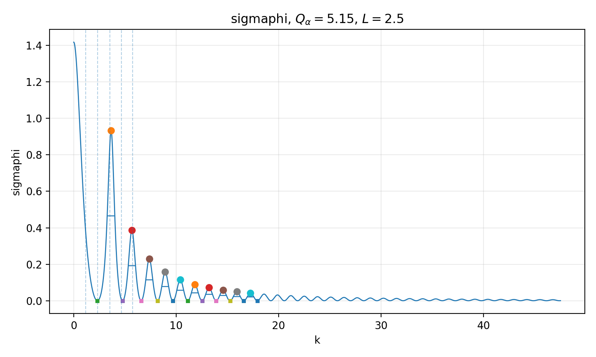

# Resonance peaks and widths in 1D square-well scattering

Python code that computes six scattering functions of a one-dimensional, single-channel square-well
potential, detects their peaks (resonances), and measures peak positions, widths and spacing. It also
finds the bound states and compares the peak spacing with the infinite-well limit.

Developed during my research in quantum scattering theory at IFUAP-BUAP.



*Resonant cross section for a well with 5 bound states (`Q_alpha = 5.15`, `a = 2.5`). Circles mark peaks,
horizontal bars the half-prominence width, squares the neighboring minima.*

## What is in the repository

| File | What it does |
|---|---|
| `AnchosNewForm.py` | Computes the functions on a fine grid, detects peaks, measures three width estimates (half-prominence, curvature, area), consecutive-peak spacing, bound states, and the comparison with the infinite well. Writes 5 CSV files and plots to `salida_Qalpha/`. |
| `casos.py` | The list of test cases (7 values of `Q_alpha`). |
| `Alphas_chek.py` | Root of `tan(α) = α` before an integer threshold `N`, for any `N >= 2`. |
| `test_validacion.py` | Automated checks (see below). |
| `ejemplo/` | One output figure and the peak table for all 7 cases. |

## Functions analysed

Written in terms of the phase `φ(k)` of the well's scattering solution: the resonant cross section
`σ_φ = 4π sin²φ / k²`, the effective path length `ℓ(k)`, the time delay `τ(k) = (ℓ − 2a)/k`, `P(k)`, and two
ratios derived from `ℓ` (`Tdt = ℓ/k`, `TdP = (ℓ − sin2φ / k)/k`). Column `funcion` in the CSV files uses the
names `sigmaphi`, `lk`, `tau`, `Pk`, `Tdt`, `TdP`.

## Parameters

`Q_alpha = α/π + 1/2`, with `α = sqrt(2|V0|)·a` the dimensionless well depth. The integer part of `Q_alpha`
is the number of bound states. The 7 cases in `casos.py` are arbitrary
(`1.70, 2.35, 3.60, 5.15, 8.45, 12.80, 20.30`); edit that list to test other wells.
Units: `ħ²/2μ = 1`, well radius `a = 2.5`.

## Run

```bash
pip install -r requirements.txt
python AnchosNewForm.py            # about 40 s
python Alphas_chek.py 4 7 15
pytest -v                          # about 40 s
```

Tested with Python 3, NumPy 2.4, SciPy 1.17, pandas 3.0, Matplotlib 3.10.

## Validation

`test_validacion.py` checks:

- `tan(α) = α` root: lies inside `((N−1)π, (N−1/2)π)`, satisfies the equation to 1e-9, and reproduces the
  known first root `4.4934094579…`.
- `ℓ(k)`: the closed formula in the code matches `ℓ = 2 dφ/dk` computed by finite differences on the phase,
  for all 7 cases.
- Bound states: `floor(Q_alpha)` states per case, each satisfying `x cos x + sqrt(α² − x²) sin x = 0`, with the
  imaginary wavenumber consistent with `x`.
- Peaks: ordered in `k`, function value at each peak equal to the value recomputed at that `k`, and
  half-prominence widths positive.

## Limitations

- The number of peaks detected per function depends on the `k` range and on the well depth: shallow wells
  show fewer peaks for some functions (for example only 2 for `TdP` at `Q_alpha = 1.7`).
- 14 of the 376 half-prominence widths are `NaN` (12 for `tau`/`Tdt`, 2 for `TdP`); those peaks have no clean
  half-height crossing and the code falls back to another width definition (`width_method`).
- Single potential family (square well), single channel, s-wave.
- Peak widths are measured on the real `k` axis, not from the poles of the S-matrix.

## How this was developed

The programs were developed iteratively with AI coding assistants. I directed the physics, defined the
quantities and conventions, and checked results against analytical limits; the tests above check the code
independently of how it was written.
